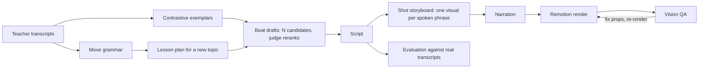

# LearnMorph

**Pedagogical style transfer for explainer videos.** LearnMorph studies how a specific teacher teaches,
then writes, narrates and animates a new lesson on a topic that teacher never covered, in that teaching style.

Most AI video tools copy a voice, a face or a colour scheme. LearnMorph targets the layer underneath:
the order of a teacher's moves. Does the lesson open with a puzzle or with a definition? Is the wrong
intuition shown before the right one? When does the picture arrive?

> **Status:** working prototype. The pipeline runs end to end and produces five-minute narrated videos.
> An independent evaluation shows the output leans toward the right teacher but does not yet read like the
> real one. Numbers and limitations are in [Results](#results) and [docs/STATUS.md](docs/STATUS.md).

## How it works



1. **Move grammar.** Each transcript is segmented into labelled teaching beats (hook, misconception,
   concrete example, visual, generalise, reprise, caveat, and others). The profile records counts,
   positions, transitions and short verbatim examples. Adjectives such as "engaging" are rejected by a judge.
2. **Contrastive exemplars.** Teacher excerpts are paired with a bland rewrite of the same content, so the
   writer sees what the style is and what it is not.
3. **Beat-level writing.** The lesson is planned as a beat sequence, then written one beat at a time.
   Several candidates are drafted per beat and a judge model picks the best.
4. **Shot storyboard.** The script is split into spoken phrases of a few seconds. Each phrase gets one
   visual: a template name plus JSON props. The model never writes animation code.
5. **Narration and timing.** Each sentence is synthesised and its measured length sets the shot length,
   so picture and voice stay in sync without forced alignment.
6. **Render and QA.** Remotion renders the storyboard. A vision model scores one frame per shot, a
   still-frame detector flags static stretches, and failing shots are repaired and re-rendered.

Every stage follows the same loop: produce, judge, retry up to three rounds. State is written to
`runs/<run-id>/` after each stage, so a rerun resumes where it stopped.

## Example

The same topic, *how to spot a misleading chart*, written from two style profiles.

**Profile built from 3Blue1Brown transcripts** (opens on a concrete puzzle):

> Here's a bar chart, the kind you'd glance at over breakfast. 'Crime Is Skyrocketing!' it says. Two bars:
> 'Last year' is tall, and 'This year' is towering. It's a little scary, right? Now I want you to do
> something most people skip. Look at the numbers on the side.

**Profile built from Khan Academy transcripts** (names the topic, then sketches live):

> Hi there. Today we're going to talk about spotting misleading charts, and I think you'll find it helps
> you more often than you'd expect. You've probably scrolled past a chart today that was quietly lying to
> you. Let me sketch one, kind of like you'd see on the news.

Full scripts, plans and storyboards for both demo runs are under [`runs/`](runs/).

## Results

Measured on two demo topics, two teacher profiles, three source transcripts per teacher.
Evaluation code and the full report: [`eval/`](eval/).

| Question | Result | Reading |
|---|---|---|
| Can a judge tell which profile a script was written from, shown only real excerpts of both teachers? | 40 of 40 | Holds for the Khan Academy profile. For the 3Blue1Brown profile it carries no information: see the next row. |
| Where does a lesson written with no style information land? | Labelled 3Blue1Brown 20 of 20 | The writer model's default voice already sits near that style, so it is a weak target for showing transfer. |
| Is generated text mistaken for the real teacher in a side-by-side choice? | 0 of 40 | Not yet. The judge cites tidy scripting and over-used signature habits. |
| Does the mix of beat types move toward the target teacher? | 3 of 4 scripts, 7 of 8 comparisons better than the unstyled control | A weak effect in the right direction. |
| Do measured speech traits match the teacher after enforcing them in code? | Mean sentence length 22.4 vs a real 25.4 (was 10.6); questions per 1,000 words 3.3 vs 3.1 (was 16.4) | Averages now match. Variation does not: sentence lengths are too even, and the side-by-side result above is unchanged. |
| Shots passing visual QA after three rounds | 55 of 78 and 51 of 70 on the latest renders (28 of 63, 42 of 59, 35 of 74 earlier) | Improved with chart templates; no render has reached a full pass. |

Known limits of these measurements: the writer and the judge are from the same model family; the corpus is
small and has no held-out transcripts; an embedding-based authorship check (`eval/luar_score.py`) is written
but has not been run. An earlier internal check scored 10 of 10 but compared scripts against the
model-written profiles, so it measured recipe-following; it is kept in the run files and labelled as such.

## Quick start

Requirements: Python 3.11+, [uv](https://docs.astral.sh/uv/), Node 18+, ffmpeg, an Anthropic API key.

```bash
uv sync
cp .env.example .env             # add ANTHROPIC_API_KEY
cd remotion && npm install && cd ..
```

Put plain-text transcripts in `data/<teacher>/*.txt` and set the topic in `config.json`.
Run everything from the project root.

```bash
# 1. Text: grammar, exemplars, plan, beats, script
uv run learnmorph.py --config config.json --run demo1

# 2. Video: visual profile and shot storyboard
uv run learnmorph_video.py --run demo1 --teacher 3b1b --source-video <url> --stop-after storyboard

# 3. Narration (ElevenLabs, kokoro-onnx or macOS say; see the docstring for model paths)
python tts_vm.py --run demo1 --teacher 3b1b

# 4. Render and vision QA
uv run learnmorph_video.py --run demo1 --teacher 3b1b --render-only

# Evaluation against real transcripts: see eval/README.md (paths in the script need pointing at your run)
```

Useful flags: `--stop-after` on the text and video stages, `--mode sentence|phrase` and `--voice` on
narration, `--no-judge` to render without QA. Environment variables read by the code: `ANTHROPIC_API_KEY`
(required), `LM_WRITER_MODEL`, `LM_JUDGE_MODEL`, `ELEVENLABS_API_KEY`, `KOKORO_ONNX_MODEL`,
`KOKORO_ONNX_VOICES`, `HEYGEN_API_KEY`.

## Repository layout

| Path | Contents |
|---|---|
| `learnmorph.py` | Text stage: grammar, exemplars, plan, beats, script |
| `learnmorph_video.py` | Visual profile, shot storyboard, render and QA loop |
| `style_traits.py` | Speech traits and habit rates measured in code, used by the writer and the evaluation |
| `tts_vm.py` | Narration and shot timing |
| `learnmorph_avatar.py` | Optional presenter renderer using a stock avatar (written, not yet run end to end) |
| `remotion/` | Props-driven video templates: equations, function plots, bar and line charts, comparisons, callouts |
| `eval/` | Evaluation against real transcripts, with report and raw results |
| `runs/demo1`, `runs/demo2`, `runs/demo3` | Text artefacts of the demo runs: profiles, plans, scripts, storyboards, QA scores, logs |
| `docs/` | [Status](docs/STATUS.md) and [changelog](docs/CHANGELOG.md) |
| `legacy/` | First version of the pipeline (Manim based), kept for reference |

## Design choices

- **The style profile is the product.** It is a readable, editable JSON file, and the renderer behind it is swappable.
- **Moves, not adjectives.** Every claim in a profile needs a count, a position or a quoted example.
- **Templates, not generated animation code.** Free-form animation code fails often and unpredictably.
  A fixed template library trades range for renders that complete.
- **Measure against the real thing.** A style check that compares output to a model-written recipe
  rewards recipe-following. The evaluation here compares against real transcripts and includes an unstyled control.

## Roadmap

1. Enforce the spread of sentence lengths and the mix of beat types, not only the averages.
2. Larger corpus per teacher with held-out transcripts, a judge from a different model family, and a test teacher the judge model has never seen.
3. More expressive narration.
4. Wider template library, driven by the visual QA failures.

## Responsible use

LearnMorph models teaching structure. It does not clone a teacher's voice or likeness: narration uses stock
voices and the optional presenter uses a stock avatar. No teacher transcripts, excerpts or video frames are
included in this repository; profiles keep only short quoted phrases as evidence. 3Blue1Brown and Khan Academy
are named as the style references used in the demos. This project is not affiliated with or endorsed by either.

## Licence

No licence has been chosen yet. Until one is added, the code is published for reading only.
